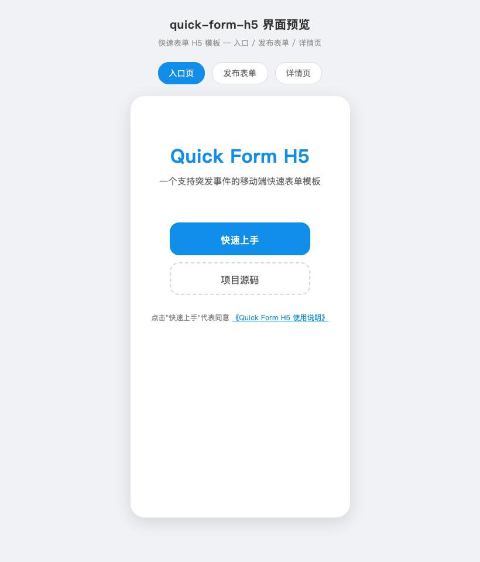
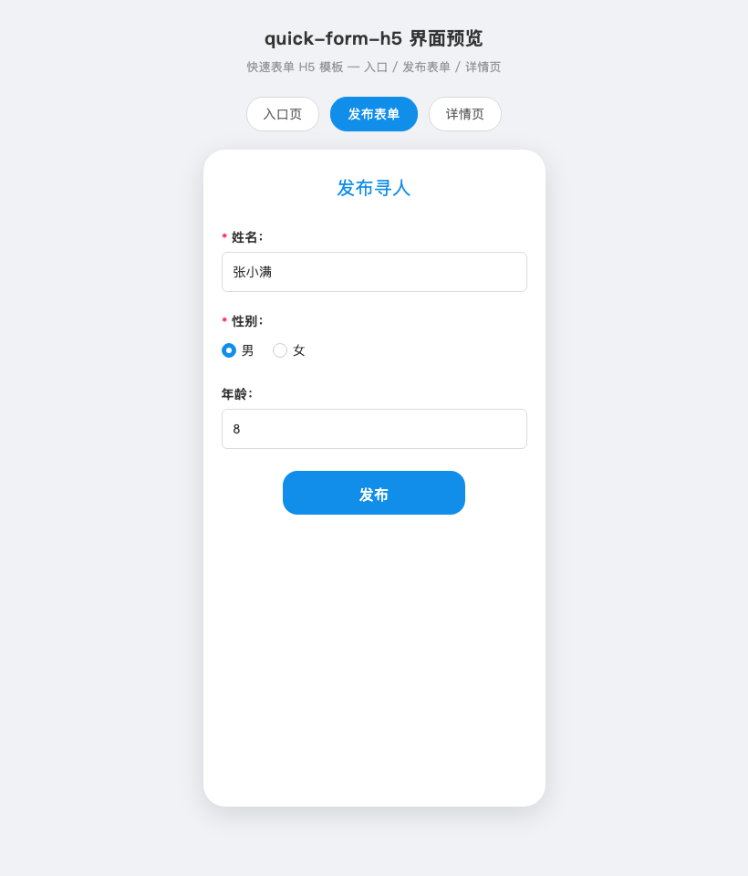
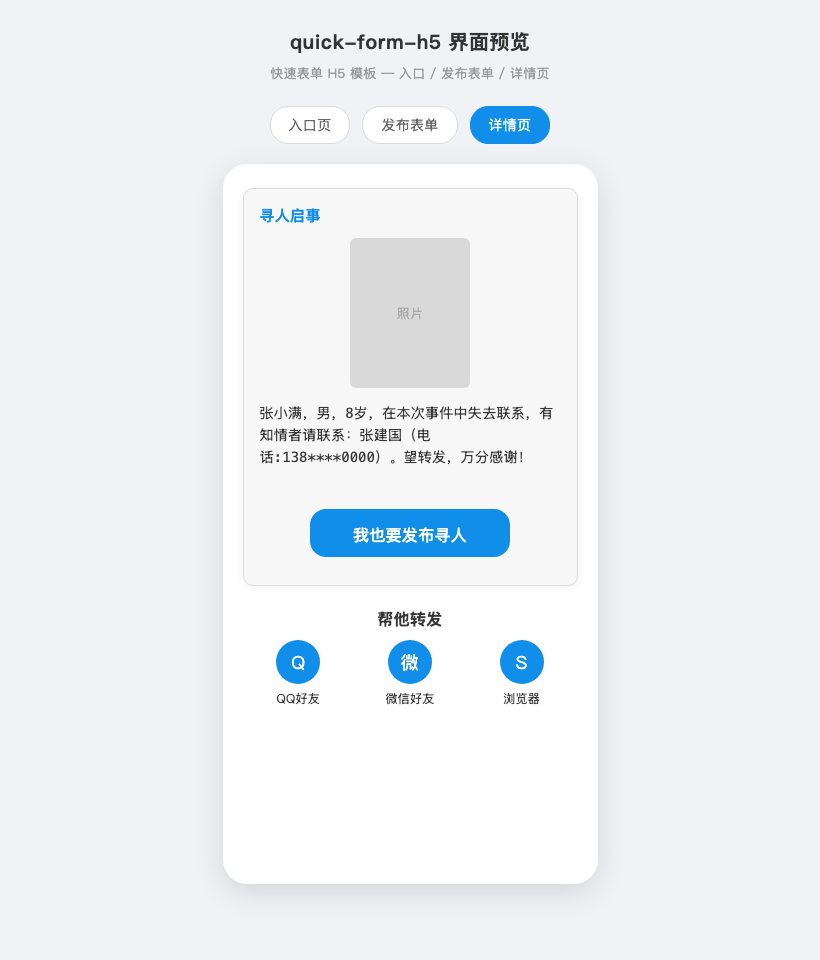

# Quick Form H5

一个移动端优先的**快速表单 H5 模板**，基于 Vue 2 + Vite 构建。面向「突发事件 / 应急发布」场景：登记信息 → 上传照片 → 生成可分享的详情页，几分钟即可上线。内置本地 mock，**无需任何后端即可完整跑通**整条发布流程。

[](LICENSE)
[](https://vuejs.org)
[](https://vitejs.dev)
[](https://github.com/NathanBoy/quick-form-h5/actions)

---

## 特性

- 🚀 **零后端可运行**：内置 `localStorage` mock，`npm run dev` 即可走完发布 → 上传 → 分享全流程
- 📱 **移动端优先**：rem 自适应 + iOS 过渡动画，老 Android WebView 自动降级为无动画
- 🧩 **可复用表单组件**：`v-input` / `v-radio` / `v-toast`，内置必填与正则校验
- 🔌 **后端可插拔**：UI 与传输解耦，改一个配置即可从 mock 切换到真实服务
- 🎞️ **页面过渡动画**：基于 [AniX](https://a-jie.github.io/AniX/) 的入场/退场动画，可随意定制

## 界面预览

<p align="center">
  
  
  
</p>

> 以上为静态界面预览，可打开 [docs/preview.html](docs/preview.html) 交互查看三个页面。

## 技术栈

- [Vue](https://vuejs.org) 2.x + [Vue Router](https://router.vuejs.org) 3.x
- [Vite](https://vitejs.dev) + [@vitejs/plugin-vue2](https://github.com/vitejs/vite-plugin-vue2)（开发 / 构建）
- [axios](https://github.com/axios/axios)（HTTP 层，默认走本地 mock）
- [Vitest](https://vitest.dev)（单元测试）、[ESLint](https://eslint.org) + [Prettier](https://prettier.io)（代码规范）
- [AniX](https://a-jie.github.io/AniX/)（动画）、[Font Awesome](https://fontawesome.com/v4.7.0)（图标）

## 目录结构

```
├── .github/               # GitHub Actions（CI / Pages 部署）与 Issue/PR 模板
├── vite.config.js         # Vite 配置（别名 / 端口 / 代理）
├── vitest.config.js       # Vitest 测试配置
├── index.html             # 入口模板（内置移动端 rem 自适应脚本）
├── src/
│   ├── main.js            # 应用入口（全局指令、插件注册）
│   ├── App.vue            # 根组件（路由过渡动画）
│   ├── config.js          # ⭐ 运行时配置（mock 模式 / baseURL）
│   ├── router/            # 路由
│   ├── utils/             # device / share / animate / bus 工具
│   ├── services/
│   │   ├── api.js         # ⭐ API 层（local / server / remote 统一出口）
│   │   └── mock.js        # ⭐ 内嵌 localStorage mock（'local' 模式）
│   ├── styles/            # 全局样式（form.css 按钮/输入框等）
│   ├── assets/            # 静态图片资源
│   └── components/
│       ├── common/        # v-input / v-radio / v-toast 表单组件
│       └── pages/         # 业务页面 page0 ~ page5
├── server/
│   └── mock-server.js     # ⭐ 本地 mock HTTP 服务器（'server' 模式）
├── static/                # 无需构建处理的静态资源
├── CONTRIBUTING.md        # 贡献指南
├── CHANGELOG.md           # 变更日志
└── LICENSE                # MIT 许可
```

## 快速开始

```bash
# 安装依赖
npm install

# 方式一：内嵌 mock（默认，零配置，无需任何服务器）
npm run dev

# 方式二：本地 mock 服务器（更接近真实 HTTP 层）
#   终端 1：启动 mock 服务器
npm run mock
#   终端 2：启动开发服务，并在 src/config.js 把 mock 改为 'server'
npm run dev

# 生产构建
npm run build

# 本地预览构建产物
npm run preview
```

开发服务默认运行在 `http://localhost:4001`。

### 开发命令

```bash
npm run lint       # ESLint 代码规范检查
npm run format     # Prettier 自动格式化
npm test           # 运行单元测试（Vitest）
npm run mock       # 启动本地 mock HTTP 服务器
```

## 页面流程

| 路由 | 页面 | 作用 |
|---|---|---|
| `/page1` | 入口 | 快速上手入口 |
| `/page2` | 发布信息 | 填写姓名 / 性别 / 年龄（带校验） |
| `/page3` | 联系方式 | 填写联系人姓名 / 电话，提交创建 |
| `/page4` | 编辑与分享 | 上传照片、编辑描述、转发到 QQ/微信/浏览器 |
| `/page5/:id` | 详情页 | 按 id 查看已发布信息，可再次转发 |
| `/page0` | 使用说明 | 项目说明 / 接入指引 |

## 数据来源：三种模式

`src/config.js` 的 `mock` 字段决定数据从哪来：

| `mock` 值 | 说明 | 如何运行 |
|---|---|---|
| `'local'`（默认） | 浏览器内 localStorage mock，零配置 | `npm run dev` 即可 |
| `'server'` | 本地 Express mock 服务器，走真实 HTTP 层 | 先 `npm run mock`，再 `npm run dev` |
| `'remote'` | 你自己的后端 | 把 `baseURL` 指向你的服务 |

```js
// src/config.js
export default {
  mock: 'local',                  // 'local' | 'server' | 'remote'
  baseURL: 'http://localhost:8081'
}
```

> `'server'` 与 `'remote'` 共用同一套 HTTP 接口契约；本地 mock 服务器基于 `express + multer`，数据保存在内存，重启即清空，仅供开发。

> **注意**：`'local'` / `'server'` 两种 mock 模式下，数据仅存于单机（localStorage 或内存），`/page5/:id` 分享链接只有本机浏览器能打开。接入 `'remote'` 真实后端后，跨设备分享才会真正生效。

按以下契约实现接口（对应 `src/services/api.js` 中的四个函数）：

| 方法 | 路径 | 说明 | 返回 |
|---|---|---|---|
| `POST` | `/notices` | 创建寻人信息 | `{ id }` |
| `POST` | `/notices/upload` | 上传图片（FormData） | `{ url }` |
| `PUT` | `/notices/:id` | 更新描述 / 图片 | 更新后的记录 |
| `GET` | `/notices/:id` | 获取单条信息 | 记录对象 |

## 如何自定义

- **表单字段**：在 `page2.vue` / `page3.vue` 的 `data` 中按 `{ title, value, isDanger, reg, isRequired, placeholder }` 声明字段，复用 `v-input` / `v-radio` 即可。
- **校验规则**：字段的 `reg` 支持任意正则；`isRequired` 控制是否必填。
- **过渡动画**：在 `src/utils/animate.js` 中新增一套 `{ enter, leave }`，再于 `App.vue` 的 `Animate.adapter('xxx')` 中引用。
- **默认图片**：替换 `src/assets/avator.jpg`（默认头像）、`src/assets/tipop.png`（分享提示图）。

## 使用场景

- **应急寻人 / 走失发布**：登记信息、上传照片、生成可转发的详情页
- **活动报名 / 信息收集**：多步表单 + 校验 + 一键提交
- **突发事件的快速落地页**：几分钟搭好一个可直接发布的移动端 H5

## 常见问题（FAQ）

- **为什么无需后端就能跑通？** 内置 `'local'`（localStorage）和 `'server'`（Express mock 服务器）两种演示模式，整条发布流程零后端可跑。
- **如何接入自己的后端？** 把 `src/config.js` 的 `mock` 改为 `'remote'` 并设置 `baseURL`，按 `src/services/api.js` 里的契约实现四个接口即可。
- **为什么用 rem？** 移动端自适应，1rem = 20px（按 320px 设计稿），适配到 640px 封顶。
- **需要什么 Node 版本？** 基于 Vite 构建，建议 Node ≥ 18；直接 `npm install && npm run dev` 即可。

## Roadmap（候选方向）

- 表单组件扩展更多控件：下拉、日期、多选
- 表单字段配置化：用 JSON 驱动页面生成
- 提供官方参考后端实现

## 部署到 GitHub Pages

仓库已内置 Pages 部署工作流（`.github/workflows/deploy.yml`，`vite.config.js` 中 `base: './'` 已配置），推送到 `master` 后会自动构建并发布。

启用步骤：

1. 进入仓库 **Settings → Pages**
2. 将 **Source** 设为 **GitHub Actions**
3. 之后每次推送到 `master`，工作流会自动构建并部署到 `https://<username>.github.io/quick-form-h5/`

## 贡献

欢迎提 [Issue](https://github.com/NathanBoy/quick-form-h5/issues) 和 Pull Request。详细规范见 [CONTRIBUTING.md](CONTRIBUTING.md)，涉及行为变更前请先开 Issue 讨论。

## License

[MIT](LICENSE) © NathanBoy
